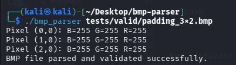
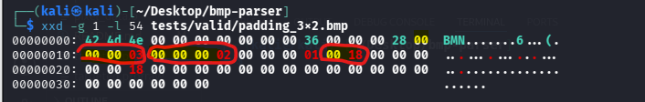
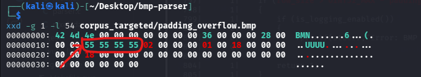
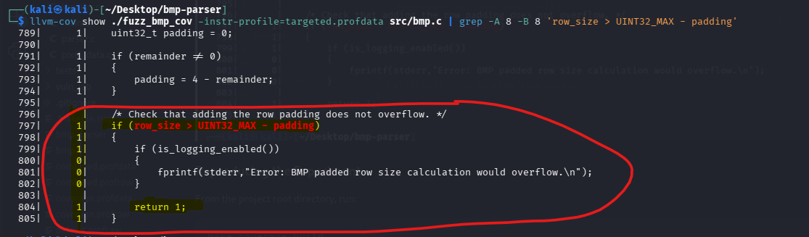
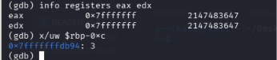
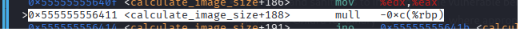
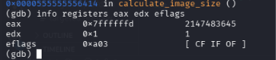
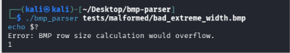

# BMP Parser & Vulnerability Research Lab

A defensive BMP parser written in C as a hands-on project for learning secure
binary parsing, memory safety, debugging, fuzzing, and vulnerability research
techniques.

The main BMP parser is implemented with explicit input validation and
integer-overflow checks. Separate small programs under `asan_lab/` and
`vuln_lab/` are used as controlled exercises for studying common memory-safety
bugs and unsafe arithmetic.


## Supported BMP Format

The parser is intentionally designed to support uncompressed 24-bit BMP images (BI_RGB).

In this format, each pixel is represented by three 8-bit color channels: Blue, Green, and Red (BGR), occupying a total of 3 bytes per pixel.

Support for 24-bit BMP was chosen to keep the parsing logic focused and manageable while concentrating on secure binary parsing, input validation, integer-overflow prevention, and memory safety.

Unlike indexed BMP formats, 24-bit BMP images do not require a color palette, allowing the project to focus on security-sensitive operations such as header validation, row-padding calculations, and pixel-data bounds checking.

Other bit depths and compressed BMP formats are outside the current scope of the parser.

## Project Goals

The project was built to practice:

- Parsing a binary file format safely in C.
- Working with attacker-controlled file input.
- Validating BMP headers and metadata.
- Preventing integer overflows in size calculations.
- Investigating program execution with GDB.
- Understanding x86-64 assembly instructions and CPU flags.
- Detecting memory-safety problems with AddressSanitizer.
- Using UndefinedBehaviorSanitizer.
- Coverage-guided fuzzing with libFuzzer.
- Measuring code coverage with LLVM tools.
- Creating targeted inputs to reach security-sensitive code paths.

## Project Structure

### `src/`

Implementation of the defensive BMP parser.

### `include/`

Header files used by the parser.

### `tests/`

BMP files used to test valid input, malformed input, and edge cases.

### `fuzz/`

The libFuzzer harness used to feed generated and mutated BMP inputs into the
parser.

### `corpus/`

Inputs used by libFuzzer during fuzzing.

### `corpus_targeted/`

Manually crafted BMP inputs designed to exercise specific security-sensitive
branches that were not sufficiently reached by the existing corpus.

The `padding_overflow.bmp` input was also added to the main `corpus/` directory
so that subsequent fuzzing and coverage runs include the previously uncovered
overflow-protection branch.

### `asan_lab/`

Small standalone C programs used to practice AddressSanitizer and understand
memory-safety errors, including:

- Heap buffer overflow
- Out-of-bounds read
- Out-of-bounds write
- Use-after-free

### `vuln_lab/`

Small controlled examples used to study integer-overflow and unsafe
size-calculation scenarios separately from the defensive BMP parser.

These programs are intentionally kept separate from the main parser.

### `docs/screenshots/`

Screenshots documenting parser execution, binary-header inspection, LLVM
coverage results, and GDB analysis.

## Building

Build the BMP parser:

```bash
make
```

Remove generated build files:

```bash
make clean
```

## Running and Inspecting a Valid BMP

The `tests/valid/` directory contains BMP files used to verify that the parser
accepts valid inputs.

The following example uses `padding_3x2.bmp`, a 3×2 pixel, 24-bit BMP file
that requires row padding.

### Running the Parser

Build the parser from the project root:

```bash
make
```

Run the parser with the sample BMP file:

```bash
./bmp_parser tests/valid/padding_3x2.bmp
```

The parser reads and validates the BMP file, prints pixel values, and reports
successful parsing:

```text
Pixel (0,0): B=255 G=255 R=255
Pixel (1,0): B=255 G=255 R=255
Pixel (2,0): B=255 G=255 R=255
BMP file parsed and validated successfully.
```



### Inspecting the BMP Header

The first 54 bytes of the file can be inspected using:

```bash
xxd -g 1 -l 54 tests/valid/padding_3x2.bmp
```

The relevant header fields are:

| Field | File offset | Raw bytes | Interpreted value |
|---|---|---|---|
| Signature | `0x00` | `42 4D` | BM |
| Width | `0x12` | `03 00 00 00` | 3 pixels |
| Height | `0x16` | `02 00 00 00` | 2 pixels |
| Bits per Pixel | `0x1C` | `18 00` | 24 bits |


### Understanding Little-Endian Byte Order

Multi-byte numeric fields in the BMP header are stored in **little-endian byte
order**, meaning that the least significant byte appears first.

For example:



- `03 00 00 00` represents the 32-bit value `0x00000003`, or 3 pixels.
- `02 00 00 00` represents the 32-bit value `0x00000002`, or 2 pixels.
- `18 00` represents the 16-bit value `0x0018`, or 24 bits per pixel.

Correctly interpreting byte order is essential when reading binary file headers
and validating attacker-controlled input.


### Understanding Row Padding

The `tests/valid/padding_3x2.bmp` file uses a 24-bit pixel format, where each pixel consists of three 8-bit color channels: Blue, Green, and Red (BGR).

Since each channel occupies one byte, each pixel requires 3 bytes (24 bits).

With an image width of 3 pixels, the unpadded row size is:

```text
row_size = width * bytes_per_pixel
         = 3 * 3
         = 9 bytes
```

BMP pixel rows are aligned to 4-byte boundaries, so 3 padding bytes are
required:

```text
padding = (4 - (row_size % 4)) % 4
        = (4 - 1) % 4
        = 3 bytes

padded_row_size = 9 + 3 = 12 bytes
```

For an image with 2 rows, the total padded pixel-array size is:

```text
pixel_array_size = 2 * 12 = 24 bytes
```

This example illustrates why a BMP parser must account for row padding when
calculating pixel-array sizes and reading image data.

### Result

The parser successfully accepted the valid BMP file and printed the expected
success message.

The hex dump independently confirms the header values used in the row-size
and padding calculations.

## Malformed BMP Input Validation

The parser includes validation checks designed to reject malformed BMP files
and report errors when invalid input is detected.

The `tests/malformed/` directory contains test cases covering invalid header
fields, unsupported values, invalid dimensions, inconsistent offsets, and
truncated pixel data.

### Example: Invalid BMP Signature

The `bad_signature.bmp` file is used to verify that the parser rejects an
invalid BMP signature.

Run the following command from the project root:

```bash
./bmp_parser tests/malformed/bad_signature.bmp
```

**Observed output:**

```text
Error: invalid BMP signature.
```

The parser detected the invalid signature and rejected the input instead of
reporting successful validation.

This test demonstrates that the BMP signature validation check correctly
rejects the tested malformed input.

## Fuzzing

Build the fuzzing target with libFuzzer, AddressSanitizer, and
UndefinedBehaviorSanitizer:

```bash
make fuzz
```

Run libFuzzer with the existing corpus:

```bash
./fuzz_bmp corpus/
```

For example, a bounded fuzzing campaign can be run with:

```bash
./fuzz_bmp corpus/ -runs=100000
```

**Logging:** Diagnostic logging is disabled in the fuzzing harness to avoid
excessive output during fuzzing and coverage runs. This does not affect the
parser's input validation or the collection of coverage data.

## Code Coverage

Build the coverage-instrumented fuzzing target:

```bash
make coverage-build
```

Run the existing corpus and collect LLVM profiling data:

```bash
make coverage-run
```

Convert the raw profiling data:

```bash
make coverage-data
```

Display the overall coverage report:

```bash
make coverage-report
```

Display source-level coverage for a specific source file:

```bash
make coverage-show FILE=src/bmp.c
```

For example:

```bash
make coverage-show FILE=src/pixel_data.c
```

## Targeted Coverage: Integer Overflow Protection

### Initial Coverage Observation

During the initial LLVM code coverage analysis, the existing fuzzing corpus
did not exercise the branch responsible for preventing integer overflow in
the BMP row-padding calculation.

To investigate this uncovered path, a targeted BMP input was manually
constructed to satisfy the overflow-check condition.

The original coverage output from this initial observation was not preserved.
The targeted input and its execution path have since been verified using
LLVM Coverage.

### Crafted BMP Input

The file `corpus_targeted/padding_overflow.bmp` contains a deliberately large
image width designed to trigger the overflow-protection branch.

The relevant BMP header fields are:

| Field | Value |
|---|---|
| Width | `0x55555555` (1,431,655,765) |
| Height | `2` |
| Bits per pixel | `24` |
| Bytes per pixel | `3` |

The resulting row-size calculation is:

```text
row_size = width * bytes_per_pixel
         = 1,431,655,765 * 3
         = 4,294,967,295
         = UINT32_MAX

padding = 1

row_size + padding = 4,294,967,296
```

The final addition would exceed the maximum value representable by a 32-bit
unsigned integer.

The BMP header values were verified using:

```bash
xxd -g 1 -l 54 corpus_targeted/padding_overflow.bmp
```



### Coverage Validation

The parser contains the following overflow-protection check:

```c
if (row_size > UINT32_MAX - padding)
{
    return 1;
}
```

The targeted BMP input was executed using a coverage-instrumented build.

LLVM Coverage confirmed that the input reached the overflow-protection branch
and executed `return 1`, rejecting the input before the unsafe addition.



### Reproducing the Experiment

From the project root directory, run:

```bash
make coverage-build
LLVM_PROFILE_FILE="targeted.profraw" ./fuzz_bmp_cov corpus_targeted/padding_overflow.bmp
llvm-profdata merge -sparse targeted.profraw -o targeted.profdata
llvm-cov show ./fuzz_bmp_cov -instr-profile=targeted.profdata src/bmp.c
```

To display only the relevant source-code region:

```bash
llvm-cov show ./fuzz_bmp_cov -instr-profile=targeted.profdata src/bmp.c | grep -A 8 -B 8 'row_size > UINT32_MAX - padding'
```

### Result

The targeted input successfully exercised the integer-overflow protection
branch, as confirmed by LLVM Coverage.

The current fuzzing corpus also covers this branch. The experiment
demonstrates how targeted input construction and source-level coverage
analysis can be used together to validate security-sensitive code paths.

This result confirms the execution of the specific protection branch; it
does not establish that every possible integer-overflow scenario is handled.

## Integer-Overflow Protection

The parser validates several size calculations before performing them,
including:

```text
width * bytes_per_pixel
row_size + padding
number_of_rows * padded_row_size
```

These checks are important because BMP header fields originate from
potentially untrusted input.

An unchecked arithmetic operation could produce a value that does not fit
within the intended integer type, potentially leading to incorrect size
calculations and unsafe memory operations.

The fuzzing corpus and targeted inputs were used to exercise these validation
paths.

The following experiment investigates the multiplication-overflow guard
at the assembly level using GDB.

### GDB Analysis: Multiplication Overflow Guard

#### Objective

The purpose of this experiment was to investigate how the compiled BMP parser
detects an integer overflow in the row-size calculation and how the resulting
error propagates through the program.

A deliberately malformed BMP file was used to trigger the multiplication
overflow guard in `calculate_image_size`.

The analysis focused on:

- Inspecting multiplication operands in registers and memory.
- Understanding the x86-64 `mull` instruction.
- Examining the 64-bit multiplication result.
- Inspecting the Carry Flag (`CF`) and Overflow Flag (`OF`).
- Following the conditional branch after multiplication.
- Verifying error propagation through the calling functions.
- Confirming that the program rejects the malformed BMP file.

#### Malformed BMP Input

The following file was used:

```text
tests/malformed/bad_extreme_width.bmp
```

Its relevant header values were:

| Field | Value |
|---|---|
| Width | `2147483647` (`0x7FFFFFFF`) |
| Height | `2` |
| Bits per pixel | `24` |
| Bytes per pixel | `3` |

The unpadded row-size calculation would be:

```text
row_size = width * bytes_per_pixel
         = 2147483647 * 3
         = 6442450941
```

However, the maximum value representable by a 32-bit unsigned integer is:

```text
UINT32_MAX = 4294967295
```

Therefore:

```text
6442450941 > 4294967295
```

The multiplication result cannot be represented in a 32-bit unsigned integer.

The parser must reject this input before using an invalid row size.

#### Inspecting the Multiplication Operands

The multiplication-overflow guard was examined in GDB.

The relevant assembly instructions were:

```asm
mov %edx,%eax
mull -0xc(%rbp)
jno ...
```

Before executing `mull`, the operands were:

```text
EAX = 2147483647
[RBP - 0xC] = 3
```

The first operand was stored in `EAX`, while the second operand was read from
a local variable in memory.

The memory operand was inspected using:

```gdb
x/uw $rbp-0xc
```

The command displays a 4-byte unsigned integer in decimal format.

The underlying bytes can also be inspected using:

```gdb
x/4xb $rbp-0xc
```

The value `3` is represented in little-endian byte order as:

```text
03 00 00 00
```



#### Understanding the MUL Instruction

The relevant instruction was:

```asm
mull -0xc(%rbp)
```

In AT&T syntax, `mull` performs an unsigned multiplication using the
32-bit value in `EAX` and a 32-bit operand from memory.

Unlike a multiplication that stores only a 32-bit result, this form of
`MUL` produces a full 64-bit result.

The result is stored across two 32-bit registers:

```text
EDX:EAX
```

Where:

- `EAX` contains the lower 32 bits.
- `EDX` contains the upper 32 bits.

The multiplication is:

```text
2147483647 * 3 = 6442450941
```

In hexadecimal:

```text
0x7FFFFFFF * 0x3 = 0x000000017FFFFFFD
```

The 64-bit result is therefore divided into:

```text
EDX = 0x00000001
EAX = 0x7FFFFFFD
```

This is important because inspecting only `EAX` would not reveal the complete
multiplication result.



#### Detecting the Overflow Using CPU Flags

After executing the multiplication instruction with GDB, the observed values
were:

```text
EAX = 0x7FFFFFFD
EDX = 0x00000001
```

The relevant flags were:

```text
CF = 1
OF = 1
```

For this form of unsigned `MUL`, the processor sets both `CF` and `OF` when
the upper half of the multiplication result is nonzero.

In this experiment:

```text
EDX = 1
```

This means that the result requires more than 32 bits.

Therefore, the multiplication cannot be represented entirely in `EAX`.

The Overflow Flag is set because the upper half of the unsigned
multiplication result is nonzero.

This differs from the interpretation of `OF` for signed arithmetic
instructions such as `ADD`, where the flag indicates signed overflow.



#### Following the Conditional Branch

The multiplication was followed by a conditional jump:

```asm
mull -0xc(%rbp)
jno ...
```

The `jno` instruction means:

```text
Jump if No Overflow
```

It performs the jump only when:

```text
OF = 0
```

In the observed execution:

```text
OF = 1
```

Therefore, the jump was not taken.

Execution continued into the error-handling path instead of proceeding with
the normal row-size calculation.

The compiled code then prepared an error indicator and checked it before
continuing.

This demonstrates that the multiplication-overflow condition was detected
and redirected to the rejection path.

The multiplication and branch instructions are part of the compiled
implementation of the parser's overflow-protection logic.

The experiment does not imply that the original C code intentionally
performed an unchecked multiplication.

#### Error Reporting

After detecting the overflow, execution reached the error-reporting code.

The relevant instructions included:

```asm
mov 0x2c4f(%rip),%rax
lea 0x1470(%rip),%rdi
mov %rax,%rcx
mov $0x30,%edx
mov $0x1,%esi
call fwrite@plt
```

The code prepares the arguments for `fwrite`, using `stderr` as the output
stream.

The error message was inspected in GDB using:

```gdb
x/s 0x5555555578a8
```

The observed message was:

```text
Error: BMP row size calculation would overflow.
```

The address shown above belongs to the analyzed debugging session and
should not be treated as a fixed address across executions.

The `fwrite` call was executed using GDB's `ni` command, and the error
message was printed.

The function then followed its error-return path.

#### Verifying Error Propagation

The next step was to verify that the failure was not handled only inside
`calculate_image_size`, but also propagated to the calling functions.

The GDB command:

```gdb
finish
```

was used to continue execution until the current function returned.

After returning to the caller, the value of `EAX` was inspected using:

```gdb
p/d $eax
```

The observed return value was:

```text
1
```

The failure propagated through the following call chain:

```text
calculate_image_size
        |
        v
validate_image_size
        |
        v
read_bitmap_info_header
        |
        v
parse_bitmap
        |
        v
main
```

Each inspected function returned a failure indicator of `1` to its caller.

The calling functions checked the returned value and followed their
respective error-handling paths.

This confirmed that the overflow was not silently ignored by the higher-level
parsing logic.

#### Final Validation: Rejecting the Malformed BMP

After completing the GDB analysis, the parser was executed normally with the
malformed input:

```bash
./bmp_parser tests/malformed/bad_extreme_width.bmp
echo $?
```

The observed output was:

```text
Error: BMP row size calculation would overflow.
1
```

The first line is the diagnostic message printed by the parser.

The second line is the process exit status, displayed using `echo $?`.

An exit status of `1` confirms that the program terminated with a failure
status rather than reporting successful parsing.

The same behavior was observed in GDB:

```text
[Inferior 1 (process ...) exited with code 01]
```



#### Result

The experiment confirmed that the parser detects the tested multiplication
overflow and rejects the malformed BMP input.

The GDB investigation demonstrated:

- How a 32-bit unsigned multiplication produces a 64-bit result in `EDX:EAX`.
- Why the upper half of the result matters when detecting overflow.
- How `CF` and `OF` indicate that the unsigned multiplication result exceeds
  32 bits.
- How the `jno` instruction controls the subsequent execution path.
- How the parser reports the error and propagates a failure indicator through
  its calling functions.
- How the program ultimately exits with a nonzero status.

This experiment demonstrates the behavior of the multiplication-overflow
guard for the tested malformed input. It does not establish complete
protection against every possible arithmetic or memory-safety vulnerability.

### Summary of Integer-Overflow Experiments

Two different arithmetic-protection paths were investigated:

| Experiment | Input | Protection mechanism | Verification |
|---|---|---|---|
| Row-padding overflow | `padding_overflow.bmp` | Prevents overflow in `row_size + padding` | LLVM Coverage |
| Row-size multiplication overflow | `bad_extreme_width.bmp` | Detects overflow in `width * bytes_per_pixel` | GDB and program exit status |

Together, these experiments demonstrate two complementary techniques for
investigating security-sensitive code:

**Coverage analysis** verifies that a particular protection branch is
executed.

**Assembly-level debugging** helps explain how the compiled code implements
the check, how the processor represents the arithmetic result, and how the
program handles the detected failure.

## Tools

- C
- GCC
- Clang
- Make
- GDB
- x86-64 Assembly
- AddressSanitizer (ASan)
- UndefinedBehaviorSanitizer (UBSan)
- libFuzzer
- LLVM profiling and coverage tools
- Git

## Educational Purpose

This project was developed for hands-on study of secure C programming and
vulnerability research methodology.

The main BMP parser is defensive code. Programs in the lab directories
contain small intentionally unsafe examples used only for controlled learning
and debugging exercises.

The experiments are intended to develop practical understanding of binary
parsing, arithmetic validation, memory safety, program execution, and
vulnerability investigation.


## Roadmap

This project is part of a hands-on learning path focused on secure C programming, binary analysis, and vulnerability research.

### Completed

- [x] Develop a defensive BMP parser with explicit input validation.
- [x] Implement integer-overflow protection for image-size calculations.
- [x] Create valid and malformed BMP inputs to test parser behavior.
- [x] Use AddressSanitizer and UndefinedBehaviorSanitizer in controlled experiments.
- [x] Implement coverage-guided fuzzing with libFuzzer.
- [x] Analyze source-level code coverage using LLVM tools.
- [x] Construct targeted inputs to exercise previously uncovered security-sensitive branches.
- [x] Investigate integer-overflow detection at the assembly level using GDB.
- [x] Verify error handling and propagation through the parser's call chain.

### Related Vulnerability Research

A separate research project focuses on **CVE-2023-52356 in libtiff**, a real-world open-source C library.

The investigation included:

- Reproducing the vulnerability in an affected version.
- Analyzing the crash using GDB and AddressSanitizer.
- Investigating the root cause of the invalid memory access.
- Examining the upstream patch.
- Verifying the behavior of the patched version.

The research is maintained in a separate repository, with documentation improvements still in progress.

### Next Steps

- [ ] Review and finalize the documentation of the libtiff vulnerability investigation.
- [ ] Expand binary-level analysis using Ghidra.
- [ ] Apply coverage-guided fuzzing to a real-world open-source target.
- [ ] Investigate unexpected crashes and identify their root causes.
- [ ] Develop a repeatable vulnerability research workflow for analyzing unfamiliar C/C++ codebases.
- [ ] Progress toward independently discovering and responsibly reporting vulnerabilities.